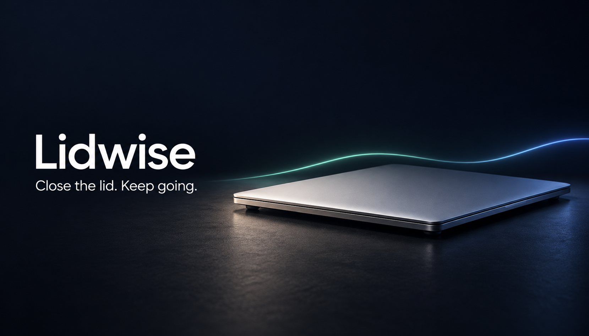

# Lidwise

<div align="center">



[](LICENSE)
[](https://www.apple.com/macos/)
[](#requirements)
[](https://github.com/proofofreach/Lidwise/releases/latest)

## Close the lid. Keep the run alive.

**A safety-bounded macOS menu-bar utility for long AI jobs, builds, renders, transfers, and remote sessions.**

### Quick install

[Download the latest release](https://github.com/proofofreach/Lidwise/releases/latest) → Unzip → Run `./install.sh`

</div>

---

> **Renamed from Closed-Lid Awake.** Version 1.0.0 installed `Closed-Lid Awake.app`
> and the `vibecaf` command. `scripts/install.sh` removes those names, including
> the old login item and sudoers rule, before it installs Lidwise.

## TL;DR

**The problem:** `caffeinate` blocks idle sleep, but closing a MacBook lid uses
a separate clamshell-sleep path. Your overnight agent run can still vanish the
moment the lid closes.

**The solution:** Lidwise pairs `pmset disablesleep` with
`caffeinate`, puts the controls in your menu bar, and restores normal sleep
automatically at 20% battery or after six hours.

Turn it on. Close the lid. Check the result from another device.

> [!CAUTION]
> Lidwise prevents normal sleep. **Never put an awake Mac in a bag,
> sleeve, drawer, or other enclosed space.** Keep it on a hard, ventilated
> surface with clear airflow.

## Why use this?

| Feature | What it does for you |
|---|---|
| **Closed-lid operation** | Keeps local work running after the lid closes |
| **20% battery floor** | Restores normal sleep before an unattended Mac runs flat |
| **Six-hour dead-man timer** | Stops a forgotten awake session automatically |
| **Wi-Fi recovery** | Gives macOS bounded, backoff-aware chances to rejoin known networks |
| **One-click menu control** | Shows power, network, guard, and auto-off state at a glance |
| **Global hotkey** | Toggles awake mode with `⌃⌥A`, even if the icon is hidden |
| **Notch recovery** | Detects a menu-bar icon trapped behind a MacBook notch and tries safer positions |
| **No telemetry** | Sends no analytics, accounts, or usage data to the project |

## Why not just use `caffeinate`?

`caffeinate` solves idle sleep. It does **not** reliably solve lid-close sleep.
Lidwise coordinates both macOS mechanisms and adds the controls needed
for unattended use.

| Capability | Normal macOS | `caffeinate` | Lidwise |
|---|:---:|:---:|:---:|
| Allows normal idle sleep | Yes | No | No |
| Keeps running with lid closed | No | No | **Yes** |
| Restores normal sleep on command | — | Yes | **Yes** |
| Battery floor | No | No | **20%** |
| Hard session limit | No | Optional timer only | **Six hours** |
| Wi-Fi recovery | No | No | **Bounded watchdog** |
| Menu-bar status and hotkey | No | No | **Yes** |

## Quick start

```text
1. Install Lidwise
2. Open it from ~/Applications
3. Click the moon icon and choose “Turn On”
4. Confirm that the menu reports “Awake mode: ON”
5. Leave the Mac on a hard, ventilated surface
6. Close the lid
```

The cup icon means awake mode is active. The app reports the current power
source, network state, guard state, and remaining time.

You can also press `⌃⌥A` anywhere or run:

```bash
lidwise toggle
```

## Requirements

- macOS 13 or later.
- An Apple Silicon or Intel Mac.
- An administrator account for the recommended safety-guard permission.
- A hard, uncovered surface with clear airflow during closed-lid use.
- Xcode Command Line Tools only when building from source.

## Installation

### From a release

No Xcode or developer tools required.

> [!IMPORTANT]
> The current community build is ad hoc signed, not Apple-notarized. macOS can
> block its first launch. If that happens, open **System Settings → Privacy &
> Security**, find the blocked-app notice, and choose **Open Anyway**. Review
> the source and [security model](SECURITY.md) before granting access.

1. Download the ZIP from
   [Releases](https://github.com/proofofreach/Lidwise/releases/latest).
2. Unzip it.
3. Open Terminal in the extracted directory.
4. Run:

```bash
./install.sh
```

The installer places:

```text
~/Applications/Lidwise.app
~/.local/bin/lidwise
```

It also asks for administrator approval to install a narrow `sudoers` rule.
The rule allows only:

```text
/usr/bin/pmset -a disablesleep 0
/usr/bin/pmset -a disablesleep 1
```

That permission lets the battery and time guard restore normal sleep while the
lid is closed. It does not grant the app a shell or unrestricted administrator
access. Read the complete [security model](SECURITY.md).

To install without the rule:

```bash
./install.sh --without-sudoers
```

> [!WARNING]
> Without the rule, the unattended guard cannot reliably restore sleep because
> nobody can answer an administrator prompt behind a closed lid.

### From source

Building requires the Xcode Command Line Tools.

```bash
git clone https://github.com/proofofreach/Lidwise.git
cd Lidwise
./scripts/check.sh
./scripts/package.sh
```

The build creates a universal Intel and Apple Silicon app in `dist/`.

## How it works

```text
┌──────────────────────────────────────────────────────────────┐
│                    Lidwise.app                      │
│  menu bar · global hotkey · state · login item · notch fix  │
└──────────────────────────────┬───────────────────────────────┘
                               │
                               ▼
┌──────────────────────────────────────────────────────────────┐
│                         lidwise                              │
│        owns the session, PID files, logs, and cleanup        │
└───────────────┬──────────────────┬──────────────────┬────────┘
                │                  │                  │
                ▼                  ▼                  ▼
       ┌────────────────┐ ┌────────────────┐ ┌────────────────┐
       │     pmset      │ │   caffeinate   │ │ safety guard   │
       │ clamshell path │ │ idle-sleep path│ │ 20% · six hours│
       └────────────────┘ └────────────────┘ └────────────────┘
                                                    │
                               ┌────────────────────┘
                               ▼
                     ┌──────────────────┐
                     │ Wi-Fi watchdog  │
                     │ bounded recovery │
                     └──────────────────┘
```

The helper treats awake mode as one owned session:

1. `pmset disablesleep 1` blocks clamshell sleep.
2. `caffeinate -i -m -s` blocks idle system and disk sleep.
3. The guard watches battery level and elapsed time.
4. The optional watchdog monitors connectivity without reading Wi-Fi passwords.
5. Turning off always attempts `pmset disablesleep 0`, even if another state
   check fails.

The helper tracks only processes it starts. It does not kill unrelated
`caffeinate` processes.

## Command line

The menu-bar app and CLI control the same state.

```bash
lidwise on            # Start an awake session
lidwise off           # Stop it and restore normal sleep
lidwise toggle        # Switch state
lidwise status        # Fast local status
lidwise status --net  # Status with a live network probe
lidwise netlog        # Show recent watchdog activity
```

Example status:

```text
AWAKE MODE: ON
Lid-close sleep blocked: yes
caffeinate pid: 12345
Wi-Fi watchdog pid: 12346
Guard pid: 12347
Auto-off in: 5h 42m
Battery floor: 20%
Network: online
Power: AC 100%
```

## Safety behavior

Lidwise reduces risk; it cannot eliminate it.

| Guardrail | Default | Purpose |
|---|---:|---|
| Battery floor | 20% | Restores sleep before battery exhaustion |
| Dead-man timer | 6 hours | Ends forgotten sessions |
| Network recovery limit | 3 failed cycles | Stops Wi-Fi thrashing |
| Passive retry window | 15 minutes | Gives macOS time to recover on its own |
| Display assertion | Disabled | Allows the display and lock screen to behave normally |

For guard testing, you can override the defaults for one shell session:

```bash
LIDWISE_DEADMAN_SECONDS=20 LIDWISE_GUARD_EVERY=5 lidwise on
sleep 40
lidwise status
```

Do not use test overrides for real unattended work.

## Wi-Fi recovery

When enabled, the watchdog:

1. Checks Apple's captive-portal test page.
2. Checks the local gateway if the internet test fails.
3. Leaves Wi-Fi alone during captive-portal or upstream failures.
4. Power-cycles Wi-Fi only after repeated link failures.
5. Stops cycling after three failed attempts and enters passive mode.

It uses networks already known to macOS. It never reads or stores Wi-Fi
credentials. Disable the watchdog for one session with:

```bash
LIDWISE_NO_NETWATCH=1 lidwise on
```

## Settings

### Start at login

Open the menu and enable **Show in menu bar at login**.

To start awake mode immediately after login, also enable
**Enable awake mode at login**. Use that option carefully: a reboot does not
preserve `pmset disablesleep`, so the app must start a new session.

### Change the hotkey

The default is `⌃⌥A`. Configure another key through macOS defaults, then
restart the app:

```bash
defaults write com.proofofreach.Lidwise HotkeyKeyCode -int 0
defaults write com.proofofreach.Lidwise HotkeyModifiers -int 3
```

Modifier values are additive:

| Modifier | Value |
|---|---:|
| Command `⌘` | 1 |
| Shift `⇧` | 2 |
| Option `⌥` | 4 |
| Control `⌃` | 8 |

## Troubleshooting

### Awake mode is on, but the Mac still sleeps

Run:

```bash
lidwise status
pmset -g | grep SleepDisabled
```

The output must show `Lid-close sleep blocked: yes` and `SleepDisabled 1`. If
not, turn the app off, reinstall the privilege rule, then turn it on again.

### The menu-bar icon disappeared

It may be behind the MacBook notch or hidden by another menu-bar manager.

- Press `⌃⌥A` to toggle awake mode.
- Quit or move a few menu-bar items.
- Reopen the app and choose **Move icon out of the notch**.
- Run `lidwise status` if you need an authoritative state check.

### Wi-Fi keeps disconnecting

Inspect the watchdog log:

```bash
lidwise netlog
```

If a VPN, captive portal, or unusual network conflicts with probing, disable
the watchdog for that session:

```bash
LIDWISE_NO_NETWATCH=1 lidwise on
```

### Normal sleep did not return

Turn the app off again, then verify the system state:

```bash
lidwise off
pmset -g | grep SleepDisabled
```

The value must be `0`. If it is still `1`, restore it directly:

```bash
sudo pmset -a disablesleep 0
```

## Limitations

- **macOS only.** The app depends on AppKit, `pmset`, and `caffeinate`.
- **No reboot persistence.** macOS clears `disablesleep` during a reboot.
- **No heat guarantee.** The guard measures time and battery, not temperature.
- **No network guarantee.** Wi-Fi, VPNs, captive portals, routers, and remote
  services can still fail.
- **No power-loss protection.** A drained battery, unplugged charger, kernel
  panic, or forced shutdown ends the job.
- **No App Store build.** The power-control model requires a narrowly scoped
  privilege rule.
- **Apple can change this.** `pmset disablesleep` is undocumented behavior.

## FAQ

### Is this the same as `caffeinate`?

No. `caffeinate` blocks idle sleep. Lidwise also controls the
clamshell-sleep setting used when the lid closes.

### Is the administrator rule safe?

It is deliberately narrow. Your account may run only the two fixed
`pmset disablesleep` commands without another password prompt. Review
[SECURITY.md](SECURITY.md) and the installer source before accepting it.

### Will it cook my Mac?

It can create unsafe conditions if you block airflow. The battery floor and
timer help, but they do not measure temperature. Keep the Mac uncovered on a
hard surface. Never run it inside a bag.

### Does it work on Intel Macs?

The release is a universal `arm64` and `x86_64` build. Intel hardware still
needs release testing before version 1.0 is published.

### Does it collect data?

No telemetry or analytics. The optional network watchdog contacts Apple's
captive-portal test page and your local gateway. See [SECURITY.md](SECURITY.md).

### Can it keep Claude, Codex, a build, or a transfer running?

It keeps macOS awake. It cannot prevent the individual process, terminal,
network, remote service, or power source from failing.

## Uninstall

From an extracted release:

```bash
./uninstall.sh
```

From a source checkout:

```bash
./scripts/uninstall.sh
```

The uninstaller restores normal sleep before it removes the app, command-line
wrapper, login item, and privilege rule.

## Contributing

Bug reports and pull requests are welcome. Useful contributions include:

- Testing across Intel and Apple Silicon Macs.
- Testing on different macOS releases.
- Hardening power-state cleanup.
- Improving network recovery without aggressive radio cycling.
- Making privilege boundaries easier to audit.

Before opening a pull request, run:

```bash
./scripts/check.sh
```

## License

MIT. Free to use, inspect, modify, and distribute.

See [LICENSE](LICENSE).
